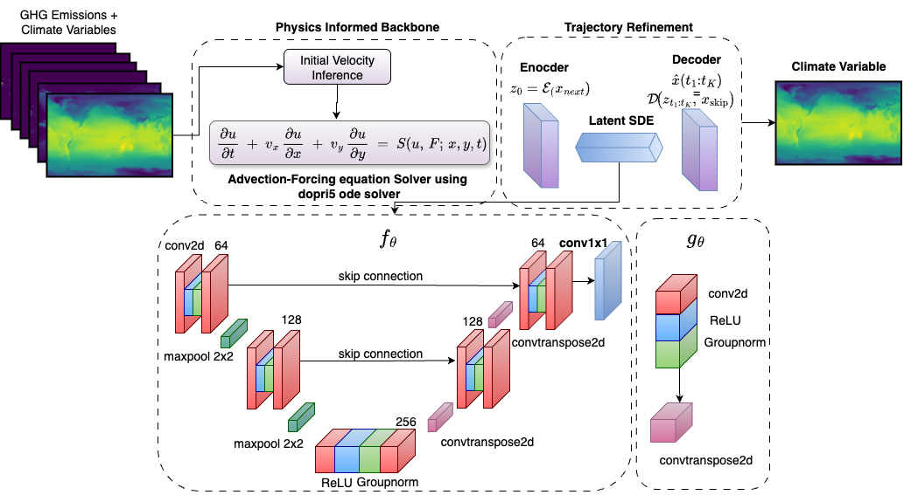

# PACE: PHYSICS INFORMED UNCERTAINTY AWARE CLIMATE EMULATOR



# Abstract:
Climate models serve as critical tools for evaluating the effects of climate change
and projecting future climate scenarios. However, the reliance on numerical simulations 
of physical equations renders them computationally intensive and inefficient. While 
deep learning methodologies have made significant progress in weather forecasting, they 
are still unstable for longer roll-out climate emulation task. Here, we propose PACER, a 
relatively lightweight 2.1M parameter Physics Informed Uncertainty Aware Climate EmulatoR. 
PACER is trained across is trained across varying spatial resolutions and climate models, 
enabling faithful and stable emulation of temperature fields at multiple surface levels over
a 10 year horizon. We propose an auto-regressive ODE–SDE framework for climate emulation 
that integrates the fundamental physical law of advection, while being trained under a 
negative log-likelihood objective to enable principled uncertainty quantification of 
stochastic variability. We show PACER’s emulation performance across 20 climate models 
outperforming relevant baselines and advancing towards explicit physics infusion in ML emulator. 

# Requirements:
* python=3.10
* torch=2.2.2
* [torchdiffeq](https://github.com/rtqichen/torchdiffeq)
* xarray
* netcdf4=1.7.1
* pytorch-lightning=2.2.3
* wandb=0.17.5
* huggingface-hub=0.24.3
* xarray
* [ClimateSet](https://github.com/RolnickLab/ClimateSet) [1] (The code follows the directory structure of ClimateSet)

# Data Preparation
Download ClimateSet data for following 15 climate models from HuggingFace.
```python
python scripts/download_climateset_huggingface.py
```
1. AWI-CM-1-1-MR
2. BCC-CSM2-MR
3. CESM2-WACCM
4. CAS-ESM2-0
5. CESM2
6. CMCC-CM2-SR5
7. CMCC-ESM2
8. CNRM-CM6-1-HR
9. EC-Earth3
10. EC-Earth3-Veg
11. EC-Earth3-Veg-LR
12. FGOALS-f3-L
13. GFDL-ESM4
14. INM-CM4-8
15. INM-CM5-0
16. MPI-ESM1-2-HR
17. MRI-ESM2-0
18. NorESM2-MM
19. TaiESM1

# Setup
1. Create virtual environment
  ```python
  python -m venv env_pace
  source env_pace/bin/activate
  pip install -r requirements.txt
  cd emulator 
  pip install -e .
  ```
2. Set Python Path
   ```python
   export PYTHONPATH=/home/user/PACE:$PYTHONPATH"
   ```
4. Set Hydra for Debugging
   ```python
   export HYDRA_FULL_ERROR=1
   ```

# Training Single Emulator
The main model path is /emulator/src/core/models/pace_net.py
```python
python emulator/run.py experiment=single_emulator/pace_net/single_pace.yaml 
```


```
[1] Kaltenborn, J., Lange, C., Ramesh, V., Brouillard, P., Gurwicz, Y., Nagda, C., ... & Rolnick, D. (2023). Climateset: A large-scale climate model dataset for machine learning. Advances in Neural Information Processing Systems, 36, 21757-21792.
```
Note: We are also constantly updating the repo to make it accustomed to more Climate models and different resolution, and removing bugs and modifying certain parts.
